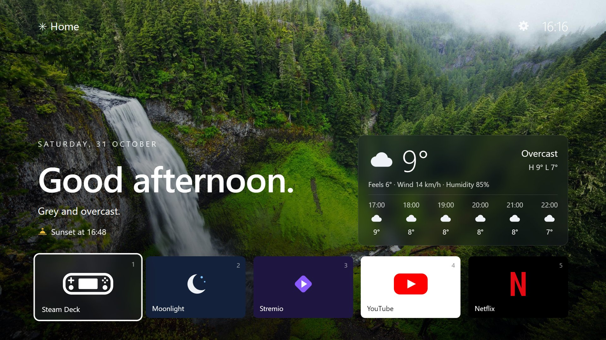
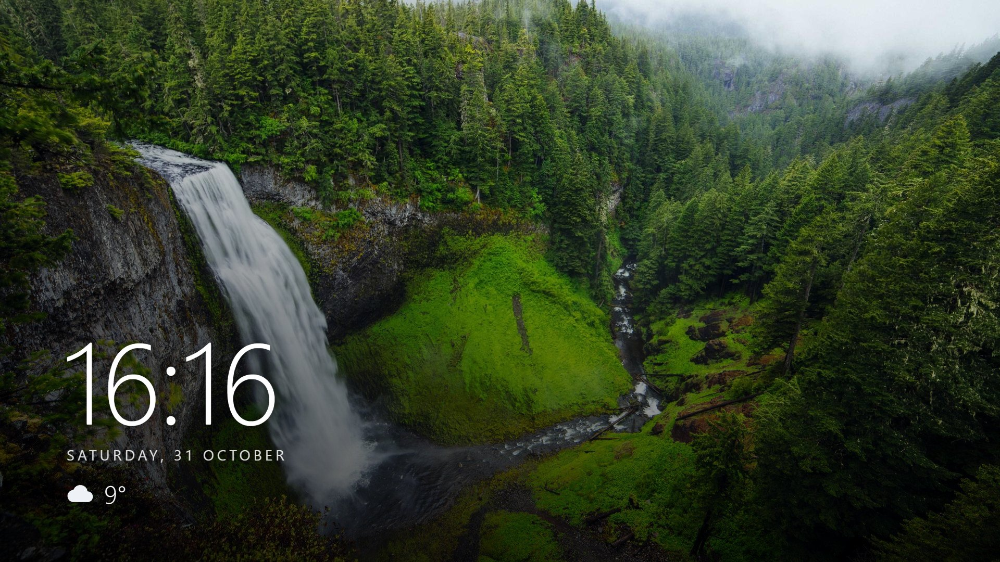
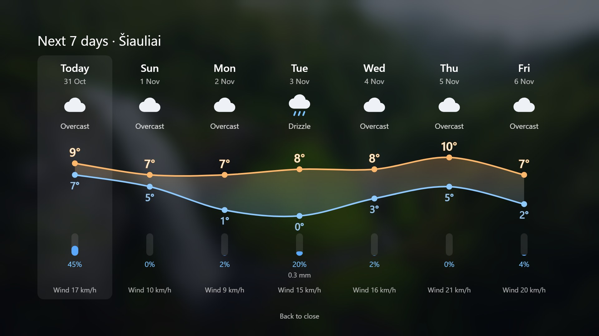
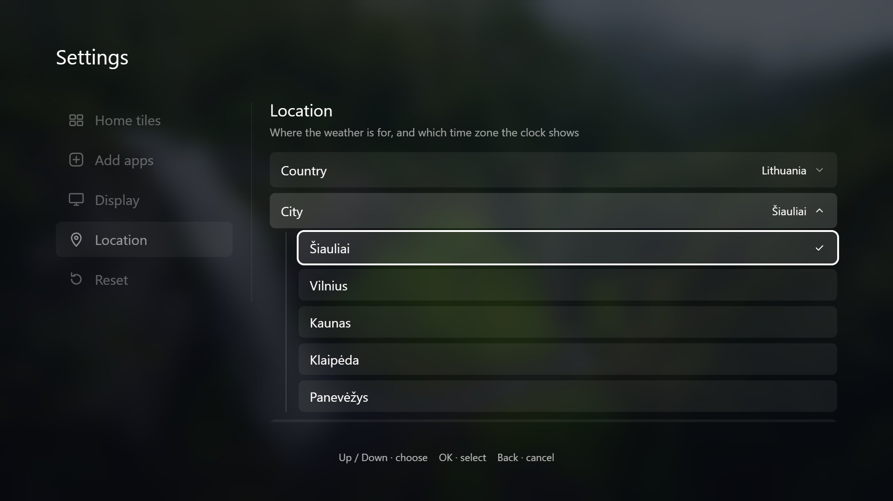

# TV Launcher

A custom home screen (Tizen web app) for a Samsung TV (UE55CU8072UXXH): a photo background that follows the time of day (or your own
pictures, imported from a USB stick), clock, weather (Šiauliai by default; country, city and time zone are set in Settings → Location) and tiles for the Steam Deck (HDMI 1), Moonlight,
Stremio, YouTube and Netflix (PC on HDMI 2 and Twitch are there too, hidden until shown in Settings). A PC-side watcher relaunches it whenever the TV powers on.
Design: `docs/superpowers/specs/2026-10-29-tv-launcher-design.md`.

Ambient screen, shown after a few idle minutes (Settings → Display → Ambient screen after):

| 7-day forecast (Up, then OK on the weather card) | Settings → Location (gear by the clock) |
|---|---|
|  |  |

## Deploy / redeploy

    powershell -ExecutionPolicy Bypass -File scripts/deploy.ps1

Should end with "successfully launched".

## Auto-launch watcher

Install or reinstall (registers a Startup shortcut, restarts the watcher):

    powershell -ExecutionPolicy Bypass -File scripts/install-watcher.ps1

Log: `watcher.log`. Also set the TV to Settings -> Advanced Features -> Start Screen Options ->
Autorun Last App (backup for when the PC is off).

## Uninstall

- `C:\tizen-studio\tools\ide\bin\tizen.bat uninstall -p TomLaunch1.Launcher -t UE55CU8072UXXH`
- Delete `%APPDATA%\Microsoft\Windows\Start Menu\Programs\Startup\TV Launcher Watcher.lnk`
- Stop the `pythonw.exe` process running `watcher.py`.

## Known limitation

Pressing Back inside Netflix/Twitch/Stremio/YouTube does not return to the launcher (those apps handle
Back themselves). Workaround: pin "Home" as the first app in Smart Hub's app row.

## Using it

Left/Right pick a tile, OK opens it, or press 1-9 to open a visible tile directly. Focus starts on the last tile opened.
Up focuses the weather card; OK there shows the 7-day forecast (a chart of each day's high and low, with the
chance and amount of rain and the top wind speed below), Back closes it. Up again focuses the gear next to
the clock; OK opens Settings. The clock and gear sit on a soft dark band at the top of the screen, with a shadow, so they
stay readable on bright pictures. After the ambient delay (3 idle minutes by default) only the photo, a big clock and the
temperature stay up; any key brings the rest back.

## Settings

Up/Down pick a section, Right or OK enters it, Left or Back goes back.

- **Home tiles**: OK on a tile opens its menu: Show/Hide on the home screen, Move (Up/Down carry it, OK drops it) and,
  for apps you added, Remove tile. At least one tile always stays visible.
- **Add apps**: lists apps installed on the TV that don't have a tile yet; OK adds one at the end. Only regular installed apps are listed (system apps, and a few Samsung apps like SmartThings, are left out).
- **Display**: ambient delay (Off, 1, 3, 5, 10 min), the weather card on/off, and the background (Photos, the
  rotating morning, day, evening and night photos; or My pictures, one of your imported pictures a day, falling back to the
  photos at any time of day none of your pictures is set for). Morning is the two hours after sunrise, evening the two
  hours before sunset and night from sunset to sunrise, using the weather's sun times (06:00 and 18:00 without weather).
- **My pictures**: plug a USB stick into the TV and press OK on Import from USB stick. It lists the pictures (jpg, png,
  webp, bmp, gif) on the stick, up to three folders deep; OK on one copies it to the TV, so the stick can be unplugged
  afterwards, and switches the background to My pictures. Back returns to your imported pictures. OK on one opens its menu: switch Morning, Day, Evening and Night on or off to pick when it shows (new pictures show at any time), or Remove picture, which needs OK twice.
- **Location**: country and city for the weather (22 countries: most of Europe plus the US, Canada, Japan and Australia; Šiauliai by default), and the
  time zone the clock and forecast use: the city's own zone (the default), UTC or any other listed zone. A new country
  starts at its first city.

On Display and Location rows, Left/Right step through the choices; OK opens the full list (Up/Down chooses, OK
selects, Back or Left cancels) and flips the weather card on/off.

- **Reset**: Home tiles, Display and Location can each go back to their defaults on their own, or all three together with **All settings** (imported pictures are kept). **My pictures** deletes every imported picture. Each row says what it will change, or that it's already at defaults, and needs OK twice.

Settings are stored on the TV (`localStorage`, key `settings-v1`); imported pictures in the app's private storage (`wgt-private/backgrounds`).

## Customising

- Built-in tiles and app ids: `launcher/js/tiles.js` (tile `id`s are stored in settings; don't rename them)
- Background photos: `launcher/bg/` by day, `launcher/bg/morning/`, `launcher/bg/evening/` and `launcher/bg/night/` for the other times of day (fetched by `scripts/fetch-backgrounds.py`)

## Tests

    node --test tests/*.test.js
    python -m unittest discover -s tests -p "test_*.py"

## Helper tools

`cam.py` (camera snapshot of the TV), `remote.py` (send TV remote keys). `token.txt` holds the TV pairing
token: keep it private, never commit it.

## License

MIT, see `LICENSE`. Background photos: see the `CREDITS.txt` in `launcher/bg/` and its folders. Not affiliated with Samsung, Valve (Steam Deck),
Netflix, YouTube, Twitch, Stremio or Moonlight; their names and logos belong to their owners.
